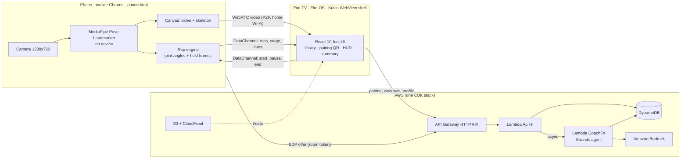

# FireFIT: a form coach for Fire TV, powered by the phone you already have

Most Fire TVs have no camera. FireFIT uses your phone as one. Pick a workout with the Fire TV remote, scan a QR code, and prop the phone up. The phone tracks your body on-device and counts only full-range reps. The TV shows you live with a skeleton overlay, rep ring, sets and rest. After each workout, an AI coach agent on AWS reviews your history and **decides your next workout**.

> **Status: in active development for the Amazon _Build, Ship, Shape_ hackathon (Fire TV track + AWS Builder).**
> [docs/PROGRESS.md](docs/PROGRESS.md) tracks what is implemented and how each part was verified (build, automated test, real device, production).
> Demo video: _coming soon_ · Release APK: _coming soon_ (see [Releases](../../releases))

## How it works



- **Privacy by design:** camera video goes from the phone to the TV over your home network. AWS never receives a camera frame, only structured workout numbers.
- **Deterministic rep counting:** a rep is an up, down, up cycle in the knee (or elbow) angle. Each threshold crossing must hold for 3 consecutive frames. Low-visibility landmarks count as "lost" and never add reps. No language model decides whether a rep happened.
- **The AI coach changes the product:** a [Strands Agents](https://strandsagents.com) coach on Lambda calls three tools: `get_profile`, `get_workout_history`, and `analyze_trends` (stats computed in code). It reasons with Amazon Bedrock and picks one of four decisions: **progress / hold / deload / technique**. Its Zod-validated plan is clamped by code guardrails (sets 1–5, reps +2 max, rest 30–120 s) and saved. The library's "Recommended next" card uses it. If the model call fails, a rules engine writes the same shape labeled `source: "rules"`, so the TV never presents a fallback as AI output.

More detail: [docs/ARCHITECTURE.md](docs/ARCHITECTURE.md).

## Repository layout

| Path | What it is |
| --- | --- |
| `apps/web` | Vite + React + TypeScript. Three pages: `tv.html` (Fire TV app), `phone.html` (sensor, no install), `probe.html` (Fire TV WebRTC capability probe) |
| `apps/api` | Lambda handlers: `api.ts` (ApiFn routes), `coach.ts` (Strands agent), `trends.ts` (stats, guardrails, rules fallback) |
| `packages/shared` | The message and API contract (Zod schemas + types) shared by phone, TV and Lambdas |
| `infra` | AWS CDK: DynamoDB, 2 Lambdas, API Gateway HTTP API, S3 + CloudFront |
| `apps/tv-shell` | Kotlin WebView shell for Fire OS (Leanback launcher, D-pad/Back, keep-screen-on) |
| `fixtures` | Sample workout payloads for API smoke tests |
| `docs` | Architecture, progress, friction log, product feedback, release checklist |

## Requirements

- A **Fire OS** Fire TV device (Fire TV Stick 4K / 4K Max / Cube). Vega OS devices such as the Fire TV Stick 4K Select can't install APKs.
- An Android phone with Chrome on the same Wi-Fi network as the TV
- Node.js 22+ and pnpm 11 (`corepack enable`)
- For deploying: an AWS account and the AWS CLI with a named profile, plus Amazon Bedrock access to Amazon Nova 2 Lite in your region
- For the TV shell: Android SDK + JDK 17–21 (Android Studio bundles both), and `adb`

## Quick start

```bash
pnpm install
pnpm assets          # copies the MediaPipe wasm runtime + downloads pose models into apps/web/public
pnpm check           # typecheck, lint, unit tests, production web build
```

### 1. Deploy AWS

```bash
export AWS_PROFILE=firefit AWS_REGION=us-east-1
cd infra && npx cdk bootstrap && cd ..
pnpm deploy:infra    # writes cdk-outputs.json (ApiUrl, SiteUrl, Bucket, DistributionId, CoachFnName)
pnpm deploy:web      # builds the web app against ApiUrl, syncs to S3, invalidates CloudFront
```

### 2. Install the TV app

Download `firefit-tv.apk` from [Releases](../../releases) and `adb install firefit-tv.apk`. To build it yourself:

```bash
cd apps/tv-shell
./gradlew assembleDebug -PfirefitUrl=https://<your-cloudfront-domain>/tv.html
adb connect <fire-tv-ip>:5555
adb install -r app/build/outputs/apk/debug/app-debug.apk
```

### 3. Work out

Open **FireFIT** from the Fire TV home row and pick **Squat Fundamentals** with the remote. Scan the QR code with your phone. Stand 2.5–3 m away with your whole body in frame.

Local development, LAN dev servers, and device debugging are covered in [docs/DEVELOPMENT.md](docs/DEVELOPMENT.md).

## Security model (demo scope, stated plainly)

- HTTPS everywhere (CloudFront and API Gateway). API Gateway CORS allows only the CloudFront origin, plus dev origins when you deploy with `DEV_ORIGINS`. Stage throttling is 20 rps with a burst of 40.
- Pairing rooms use a random 6-digit code plus a random per-room token. The token is required on every signaling call and compared in constant time. Rooms expire after 15 minutes (DynamoDB TTL).
- All input is validated with Zod. IAM is scoped per function: only CoachFn can call Bedrock.
- **Limitation:** there are no user accounts yet. Everyone shares a single guest profile, and the profile and workout routes are protected only by CORS, throttling, and validation. CORS is not authentication. Amazon Cognito is the next step.

## Known limitations

- The phone and TV must be on the same Wi-Fi network (no TURN server). Guest networks with client isolation block the peer connection.
- One person in frame. Squats are the primary exercise; push-ups need a side view with the phone at floor level.
- Camera-derived depth and tempo are heuristics for training feedback. They are **not medical or clinically validated measurements**.

## Credits and licenses

- FireFIT is MIT licensed: see [LICENSE](LICENSE).
- [MediaPipe Tasks Vision](https://github.com/google-ai-edge/mediapipe) and its Pose Landmarker models are Apache 2.0, by Google.
- [Strands Agents SDK](https://github.com/strands-agents) is Apache 2.0.
- Amazon Nova via Amazon Bedrock. React, Vite, Zod, AWS CDK and the AWS SDK for JavaScript are each under their own open-source licenses.

## Built during the hackathon

FireFIT is a new project. All code was written during the Build, Ship, Shape submission window (Oct 2026).
