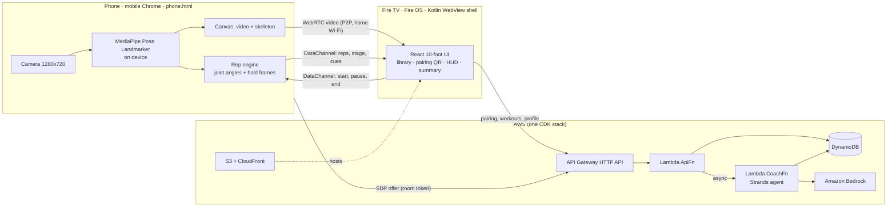

# FireFIT: an AI form mirror for Fire TV, powered by the phone you already have

FireFIT turns your TV into an AI form mirror: on-device computer vision tracks 33 body points and draws a live skeleton over your video, with AR-style real-time form highlights.

Most Fire TVs have no camera. FireFIT uses your phone as one. Start the session with the Fire TV remote, scan a QR code, and prop the phone up. One 10–12 minute session runs **squats, push-ups and a plank**: the phone tracks your body on-device, counts only full-range reps, and times the plank only while your body line is straight. The TV shows you live with a skeleton overlay, rep ring, form check, rests and an estimated calorie count. Afterwards the summary breaks down every set (time between reps, tempo, depth, hold), and an AI coach agent on AWS streams its review onto the TV, **reads it aloud with Amazon Polly**, and **decides your next session**.

> **Status: in active development for the Amazon _Build, Ship, Shape_ hackathon (Fire TV track + AWS Builder).**
> [docs/PROGRESS.md](docs/PROGRESS.md) tracks what is implemented and how each part was verified (build, automated test, real device, production).
> Demo video: _coming soon_ · Release APK: [`firefit.apk`](https://github.com/jimmieldavisjr/firefit-tv/releases/latest/download/firefit.apk) (see [Releases](../../releases))

## Install on Fire TV

FireFIT runs on **Fire OS 6, 7 and 8** devices (Fire TV Stick 4K / 4K Max, Fire TV Cube and others). Vega OS devices, such as the Fire TV Stick 4K Select, can't install APKs: the demo video is the way to see FireFIT there.

The newest APK is always at:

```
https://github.com/jimmieldavisjr/firefit-tv/releases/latest/download/firefit.apk
```

**A) Easy, no computer**

1. On the Fire TV, install **Downloader** (by AFTVnews) from the Amazon Appstore.
2. Go to **Settings › My Fire TV › About** and click the device name 7 times to unlock Developer Options.
3. Go to **Settings › My Fire TV › Developer Options › Install unknown apps** and turn **Downloader** on.
4. Open Downloader, type the APK link above (or its short link), and install.
5. Open **FireFIT** from **Your Apps & Channels**. Optional: press the Menu (☰) button on it and choose **Move to front** to pin it to the home row.

**B) Developer (adb)**

1. **Settings › My Fire TV › Developer Options › ADB debugging** on.
2. Then:

```bash
adb connect <fire-tv-ip>:5555
adb install firefit.apk
```

**Then work out:** create your profile, press **Start**, and scan the QR code with your phone's camera. No app install on the phone. Prop the phone up in landscape 2.5–3 m away with your whole body in frame. The TV tells you when to move the phone to floor level for push-ups and the plank.

**No Fire TV?** Open [phone.html](https://dctlk09e4uy0d.cloudfront.net/phone.html) in Chrome on a laptop with a webcam (or on a phone) and use the self-test buttons to see live rep counting for squats, push-ups and the plank without a TV.

### Compatibility and troubleshooting

- **Phone:** Android with Chrome is the tested setup. iPhone Safari is untested.
- **Network:** the TV and phone must be on the **same main Wi-Fi**. Guest and office networks, and some mesh routers, block device-to-device connections. If pairing fails, the TV says so and offers **Re-pair**; turning on your phone's hotspot and joining the TV to it is a reliable workaround.
- **Framing:** stand 2.5–3 m back with your whole body in frame. Squats need a front view; push-ups and the plank need a side view with the phone at floor level.
- **Phone stuck on "Loading pose model":** keep the page open on Wi-Fi; the first load downloads the model (about 9 MB).

## How it works



- **Privacy by design:** camera video goes from the phone to the TV over your home network. AWS never receives a camera frame, only structured workout numbers.
- **Deterministic tracking:** a rep is an up, down, up cycle in the knee (squat) or elbow (push-up) angle, and each threshold crossing must hold for 3 consecutive frames. Push-ups only count with the torso horizontal, so arm bends while standing never count. The plank timer runs only while the shoulder-hip-ankle line is straight, with sag/pike cues. Low-visibility landmarks count as "lost" and never add anything. No language model decides whether a rep happened.
- **Household profiles:** the first launch asks for a name, level, weight and goal (typed with the Fire TV keyboard); anyone can switch or add a profile from the library. Each profile has its own history and coach. Past sessions open an after-action report with the coach's analysis.
- **Calories are an estimate:** MET values (Compendium of Physical Activities) × body weight (default 80 kg) × time, labeled "est." everywhere.
- **The AI coach changes the product:** a [Strands Agents](https://strandsagents.com) coach on Lambda calls three tools: `get_profile`, `get_workout_history`, and `analyze_trends` (stats computed in code). It reasons with Amazon Bedrock and picks one of four decisions: **progress / hold / deload / technique**. Its Zod-validated plan is clamped by code guardrails (sets 1–5, reps +2 max, rest 30–120 s) and saved. The library's "Recommended next" card uses it. If the model call fails, a rules engine writes the same shape labeled `source: "rules"`, so the TV never presents a fallback as AI output.

More detail: [docs/ARCHITECTURE.md](docs/ARCHITECTURE.md).

## Repository layout

| Path | What it is |
| --- | --- |
| `apps/web` | Vite + React + TypeScript. Three pages: `tv.html` (Fire TV app), `phone.html` (sensor, no install), `probe.html` (Fire TV WebRTC capability probe) |
| `apps/api` | Lambda handlers: `api.ts` (ApiFn routes), `coach.ts` (Strands agent), `trends.ts` (stats, guardrails, rules fallback) |
| `packages/shared` | The message and API contract (Zod schemas + types) shared by phone, TV and Lambdas |
| `infra` | AWS CDK: DynamoDB, 2 Lambdas, API Gateway HTTP API, S3 + CloudFront |
| `apps/tv-shell` | Kotlin WebView shell for Fire OS (Leanback launcher, D-pad/Back, keep-screen-on) |
| `fixtures` | Sample workout payloads for API smoke tests |
| `docs` | Architecture, progress, friction log, product feedback, release checklist |

## Requirements

- A **Fire OS** Fire TV device (Fire TV Stick 4K / 4K Max / Cube). Vega OS devices such as the Fire TV Stick 4K Select can't install APKs.
- An Android phone with Chrome on the same Wi-Fi network as the TV (iPhone Safari is untested)
- Node.js 22+ and pnpm 11 (`corepack enable`)
- For deploying: an AWS account and the AWS CLI with a named profile, plus Amazon Bedrock access to Amazon Nova 2 Lite in your region
- For the TV shell: Android SDK + JDK 17–21 (Android Studio bundles both), and `adb`

## Quick start

```bash
pnpm install
pnpm assets          # copies the MediaPipe wasm runtime + downloads pose models into apps/web/public
pnpm check           # typecheck, lint, unit tests, production web build
```

### 1. Deploy AWS

```bash
export AWS_PROFILE=firefit AWS_REGION=us-east-1
cd infra && npx cdk bootstrap && cd ..
pnpm deploy:infra    # writes cdk-outputs.json (ApiUrl, SiteUrl, Bucket, DistributionId, CoachFnName)
pnpm deploy:web      # builds the web app against ApiUrl, syncs to S3, invalidates CloudFront
```

### 2. Install the TV app

See [Install on Fire TV](#install-on-fire-tv) for the release APK. To build it yourself:

```bash
cd apps/tv-shell
./gradlew assembleDebug -PfirefitUrl=https://<your-cloudfront-domain>/tv.html
adb connect <fire-tv-ip>:5555
adb install -r app/build/outputs/apk/debug/app-debug.apk
```

### 3. Work out

Open **FireFIT** from the Fire TV home row, create a profile, and press **Start**. Scan the QR code with your phone. Stand 2.5–3 m away with your whole body in frame.

Local development, LAN dev servers, and device debugging are covered in [docs/DEVELOPMENT.md](docs/DEVELOPMENT.md). Appstore assets and listing text (tile, cover background, descriptions) are in [docs/store-assets](docs/store-assets/LISTING.md).

**Audio:** `node scripts/gen-audio.mjs` regenerates the bundled sound effects and music with an ElevenLabs key in `.env.elevenlabs` (gitignored). The Kotlin shell plays them offline (Media3 ExoPlayer for music, SoundPool for effects); music and effects volumes are on the home screen.

## Security model (demo scope, stated plainly)

- HTTPS everywhere (CloudFront and API Gateway). API Gateway CORS allows only the CloudFront origin; dev origins are added only when a development deploy sets `DEV_ORIGINS` (the production stack has none). Stage throttling is 20 rps with a burst of 40.
- Pairing rooms use a random 6-digit code plus a random per-room token. The token is required on every signaling call and compared in constant time. Rooms expire after 15 minutes (DynamoDB TTL).
- All input is validated with Zod. IAM is scoped per function: only CoachFn can call Bedrock.
- **Limitation:** profiles have no passwords (like streaming-app profiles on a shared TV). Requests name a profile with an `x-profile-id` header, and the profile and workout routes are protected only by CORS, throttling, and validation. CORS is not authentication. Amazon Cognito is the next step.

## Known limitations

- The phone and TV must be on the same Wi-Fi network (no TURN server). Guest networks with client isolation block the peer connection.
- One person in frame. Squats need a front view; push-ups and the plank need the phone at floor level in side view (the TV prompts the move).
- Camera-derived depth and tempo are heuristics for training feedback. They are **not medical or clinically validated measurements**.

## Credits and licenses

- FireFIT is MIT licensed: see [LICENSE](LICENSE).
- Exercise photos, cover art and the FireFIT logo artwork were provided by the project owner; third-party logos on shoes are blurred in the app's copies.
- [lucide](https://lucide.dev) icons are ISC licensed.
- Sound effects were generated with [ElevenLabs](https://elevenlabs.io) (Sound Effects API) at development time and are bundled in the app; the app never calls ElevenLabs. Read-aloud reports use Amazon Polly.
- [MediaPipe Tasks Vision](https://github.com/google-ai-edge/mediapipe) and its Pose Landmarker models are Apache 2.0, by Google.
- [Strands Agents SDK](https://github.com/strands-agents) is Apache 2.0.
- Amazon Nova via Amazon Bedrock. React, Vite, Zod, AWS CDK and the AWS SDK for JavaScript are each under their own open-source licenses.

## Built during the hackathon

FireFIT is a new project. All code was written during the Build, Ship, Shape submission window (Oct 2026).
