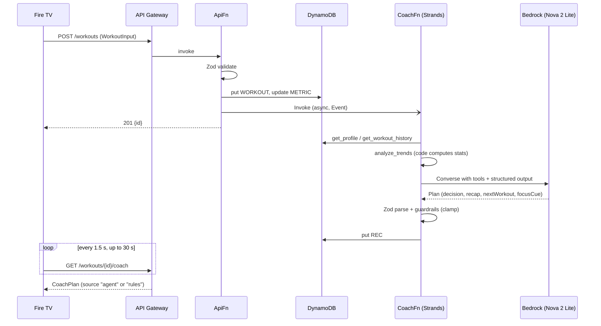

# Architecture

FireFIT has three parts: a **phone** that senses, a **Fire TV** that runs the workout, and **AWS**, which remembers and coaches.

## Data paths

| Path | Transport | Payload | Never carries |
| --- | --- | --- | --- |
| Phone → TV video | WebRTC P2P (same Wi-Fi), ~2.5 Mbps cap | Mirrored camera frames with the skeleton drawn in (`canvas.captureStream(30)`) | — |
| Phone → TV telemetry | WebRTC DataChannel (ordered, reliable) | `hello`, `state` (~10 Hz: reps, stage, angle, visible, fps), `rep` (depth, tempo, cue) | — |
| TV → Phone commands | Same DataChannel | `config`, `start`, `pause`, `resetSet`, `end` | — |
| TV/Phone → AWS signaling | HTTPS to API Gateway, with an `x-room-token` header | One SDP offer and one SDP answer per room (non-trickle ICE) | Video |
| TV → AWS workouts | HTTPS to API Gateway | `WorkoutInput`: sets, reps, duration, per-rep depth/tempo/cue | Video, images |
| CoachFn → Bedrock | AWS SDK (Converse) | Prompt plus tool results (numbers only) | Video, images |

All contracts are defined once in [`packages/shared/src/index.ts`](../packages/shared/src/index.ts).

## Roles

- **The phone is authoritative for reps.** It runs MediaPipe Pose Landmarker (Full model, GPU delegate; falls back to Lite on CPU) and the deterministic [`RepEngine`](../apps/web/src/phone/repEngine.ts).
- **The TV is authoritative for workout progress.** It runs the state machine `LIBRARY → PAIR → READY → ACTIVE → REST → … → COMPLETE`, plus `LOST` (counting paused) and `DISCONNECTED` (offer to re-pair). The remote drives everything; no laptop is involved.
- **AWS** handles pairing rooms, workout persistence, history and the coach. It is never in the real-time loop.

## Rep engine

- Joint angle at the knee (squat: hip, knee, ankle) or the elbow (push-up: shoulder, elbow, wrist), computed from **world landmarks** (metric 3D). Phone orientation and aspect ratio therefore don't skew it. The engine uses whichever side is more visible.
- EMA smoothing (α = 0.5). Stage moves `up → down` at ≤ 105° and `down → up` at ≥ 160° (squat). Each crossing must hold for **3 consecutive frames**, and reps must be **≥ 600 ms apart**.
- If visibility drops below 0.6 the stage is `lost` and nothing is counted. A tracking gap over 1.5 s mid-rep abandons that rep, so it can't complete later.
- Per-rep log: depth (the bottom angle), tempo (s), and a form cue (squat: knees caving relative to ankles; push-up: hip line).
- Unit tests in [`repEngine.test.ts`](../apps/web/src/phone/repEngine.test.ts) cover full and half squats, single-frame spikes, low visibility, tracking loss and cues.

## AWS

| Route | Purpose | Auth |
| --- | --- | --- |
| `POST /rooms` | TV creates a pairing room → `{code, token, expiresAt}` | CORS + throttle |
| `GET/PUT /rooms/{code}/{offer\|answer}` | SDP exchange | per-room token (constant-time compare), 15-min TTL |
| `POST /workouts` | Save the workout, update metrics, start the coach asynchronously | CORS + throttle + Zod |
| `GET /workouts/{id}/coach` | 202 until the plan exists, then the `CoachPlan` | CORS + throttle |
| `GET /profile` | Active profile, next session plan, metrics, recent sessions | CORS + throttle + `x-profile-id` |
| `GET/POST /profiles` | List household profiles / create one (name, level, goal, weight) | CORS + throttle + Zod |
| `GET /workouts/{id}` | After-action report: the saved session plus its coach run | CORS + throttle + `x-profile-id` |
| `GET /workouts/{id}/voice?p=` | Amazon Polly MP3 of the report (what went well / what to fix / next time); 202 until the coach finishes | throttle; profile in the query because `<audio src>` can't send headers |

### DynamoDB single-table layout

| pk | sk | Item |
| --- | --- | --- |
| `PROFILES` | `P#<id>` | id, name, level, goal, weightKg, createdAt (household registry) |
| `USER#<profileId>` | `PROFILE` | name, goal, level, nextWorkout, focusCue, lastDecision |
| `USER#<profileId>` | `WORKOUT#<iso>#<id>` | WorkoutInput + id + completedAt |
| `USER#<profileId>` | `METRIC#<exercise>` | sessions, totalReps, bestReps, lastAt |
| `USER#<profileId>` | `REC#<workoutId>` | CoachPlan + source + model + toolCalls + latencyMs |
| `ROOM#<code>` | `META` | token, offer, answer, ttl |

### Coach decisions and guardrails

| Decision | Rule given to the agent (and used by the fallback) | Next workout |
| --- | --- | --- |
| progress | target met, form cue on < 30% of reps | targetReps + 2 |
| hold | target missed, or tempo SD > 0.8 s | same |
| deload | reps down > 20% vs previous average | targetReps − 2 (min 3) |
| technique | form cue on ≥ 30% of reps | same targets; focusCue = most common cue |

Code clamps every plan before saving: sets 1–5; reps 3–20 and at most +2 per step; rest 30–120 s. Each run logs one CloudWatch line: `{"evt":"coach_run", source, model, decision, toolCalls, latencyMs, error}`.

## Fallback ladder (decided at gates)

| Level | When | What changes |
| --- | --- | --- |
| L0 | Default | Live video with the skeleton baked in + DataChannel |
| L1 | Choppy video | Prefer H.264, 960×540 at 24 fps, 1.5 Mbps; Lite pose model |
| L2 | Video won't decode, DataChannel works | Landmarks sent in `state`; the TV draws the skeleton on a dark stage ("privacy mode") |
| L3 | No WebRTC in the WebView | Phone POSTs state at 4 Hz, TV polls; reps and cues stay live, no skeleton |
